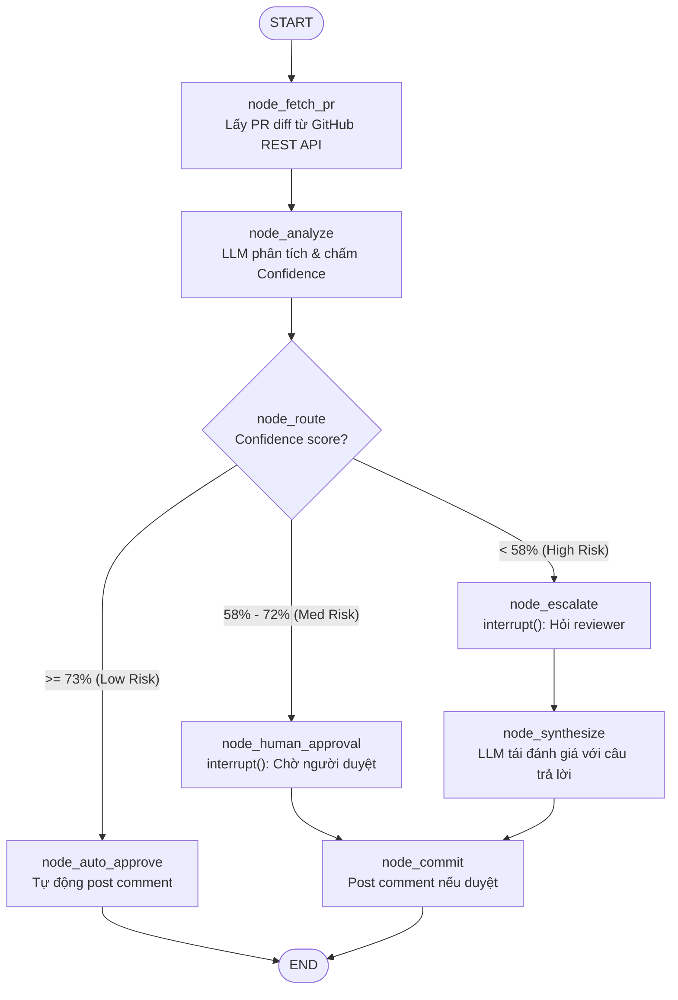
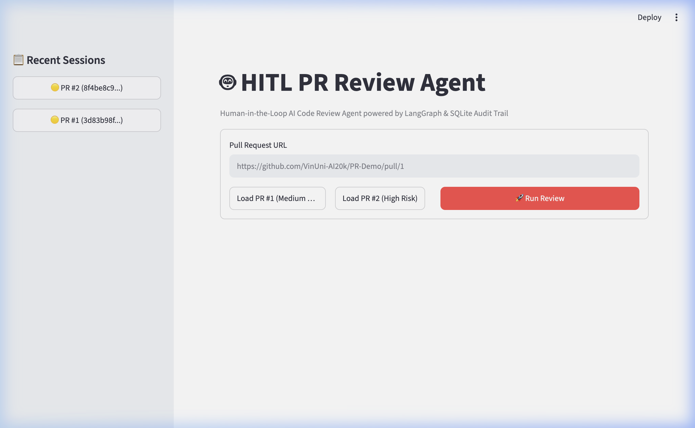
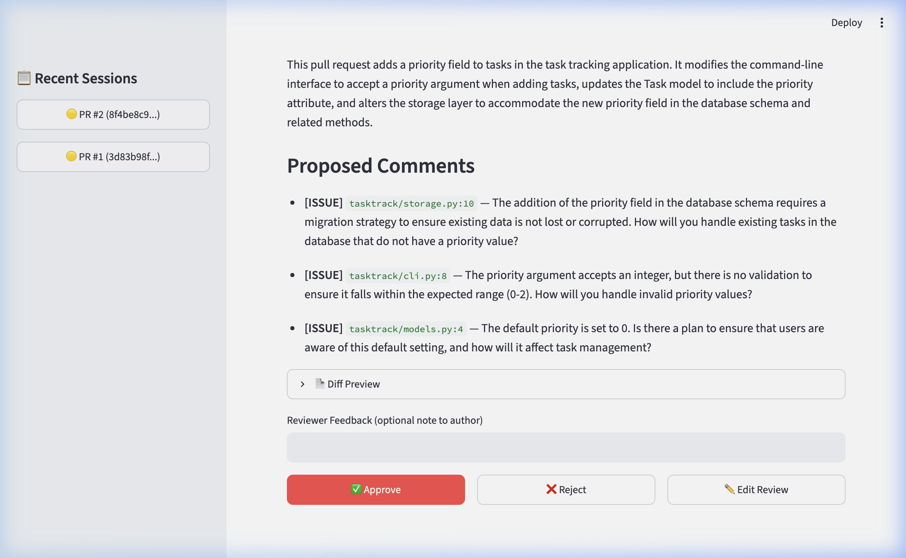
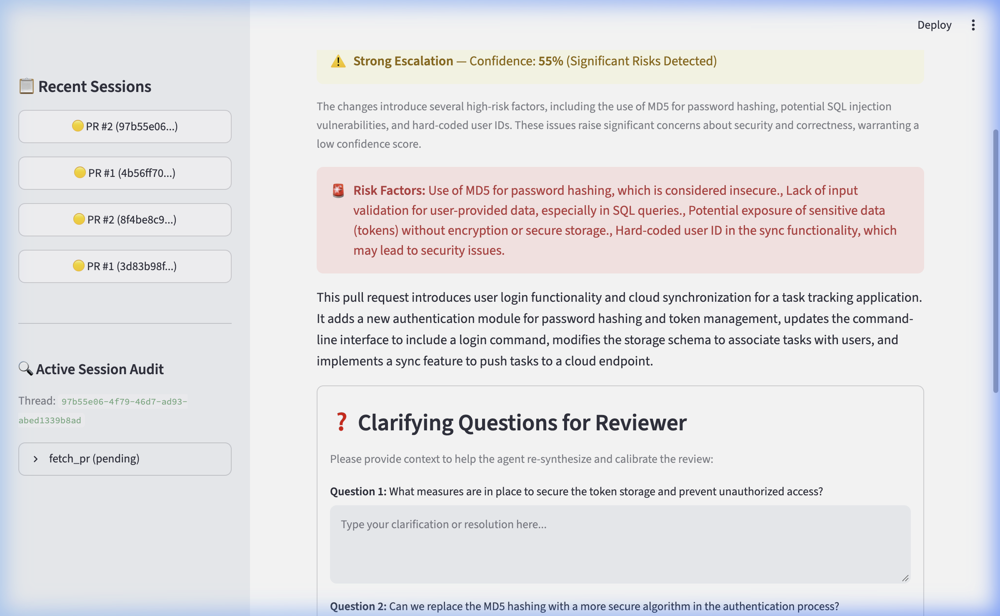
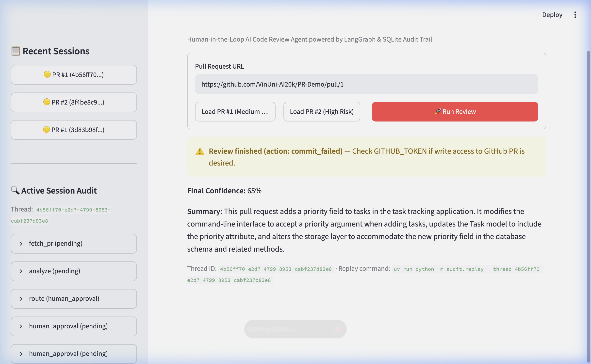
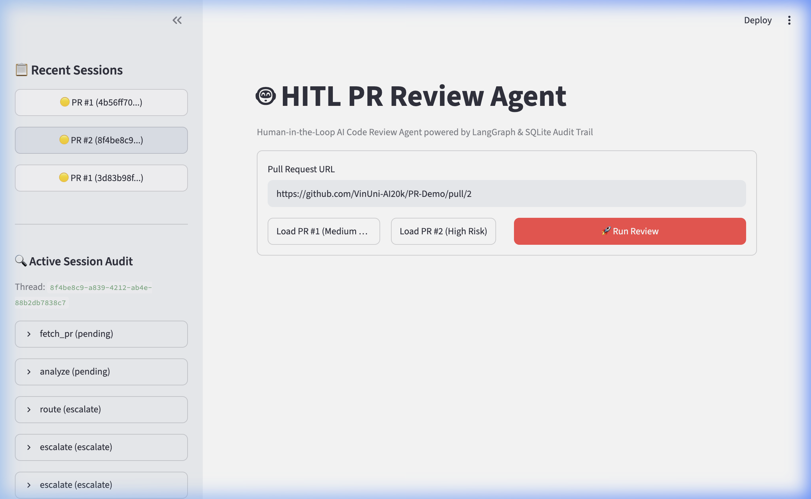

# Hướng Dẫn Chi Tiết: Human-in-the-Loop (HITL) Pull-Request Review Agent

Tài liệu này được biên soạn chi tiết nhằm giúp bạn hiểu sâu sắc về kiến trúc, nguyên lý hoạt động, cách triển khai kỹ thuật và kết quả thực tế của hệ thống **Human-in-the-Loop (HITL) PR Review Agent** được xây dựng trên nền tảng **LangGraph**.

---

## 1. Bài Toán Thực Tế: Code Review Bottleneck

### 1.1 Vấn đề trong quy trình kỹ thuật phần mềm
Trong các đội ngũ phát triển, **Code Review** luôn là một điểm nghẽn (bottleneck) lớn:
- Thời gian của các kỹ sư cấp cao (Senior Engineer / Tech Lead) rất có hạn và đắt giá.
- Hàng ngày có hàng chục Pull Request (PR) được gửi lên với các mức độ rủi ro rất khác nhau:
  1. **Mechanical (Trivial / Rủi ro thấp)**: Sửa lỗi chính tả (typo), cập nhật dependency, đổi tên biến. Các PR này rất an toàn nhưng vẫn bắt một kỹ sư vào bấm nút "Approve". Việc này gây lãng phí lớn thời gian chất xám.
  2. **Medium Risk (Rủi ro trung bình)**: Bổ sung tính năng nhỏ, thêm trường vào database schema. Những PR này thường ổn nhưng cần mắt người kiểm tra các ca biên (edge cases).
  3. **High Risk (Rủi ro cao)**: Thay đổi phân quyền, xác thực (auth), mã hóa mật khẩu, migration dữ liệu lớn, endpoint không có test. Những PR này bắt buộc phải có chuyên gia soi xét kỹ, thậm chí cần chất vấn tác giả về threat model và quyết định kiến trúc.

Nếu đối xử với mọi PR theo cùng một cách thủ công, đội ngũ sẽ vừa **lãng phí thời gian vào PR vụn vặt**, vừa **không đủ tập trung cho các PR nguy hiểm**.

### 1.2 Giải pháp Human-in-the-Loop (HITL) Agent
Agent này tự động phân luồng (auto-triage) mọi PR theo mức độ tin cậy:
1. LLM đọc diff và xuất ra một phân tích có cấu trúc kèm **điểm tin cậy (Confidence Score)** tự đánh giá (từ 0.0 đến 1.0).
2. Phân loại theo 3 ngưỡng (Thresholds trong `common/schemas.py`):
   - **Confidence > 72%** $\rightarrow$ `auto_approve`: Agent tự đăng bình luận duyệt PR lên GitHub; không làm phiền con người.
   - **58% – 72%** $\rightarrow$ `human_approval`: Agent tạm dừng (`interrupt()`), hiển thị tóm tắt, lý do, diff và 3 nút: **Approve / Reject / Edit**. Sau khi reviewer bấm, hệ thống tiếp tục (`resume`).
   - **Confidence < 58%** $\rightarrow$ `escalate`: Agent tạm dừng, đưa ra **các câu hỏi cụ thể** mà mô hình còn thắc mắc (ví dụ: *"Tại sao dùng MD5? Endpoint sync này đã hỗ trợ HTTPS chưa?"*). Chờ người review trả lời, sau đó Agent **tổng hợp lại đánh giá (synthesize)** với câu trả lời của con người rồi mới hoàn tất.
3. Mọi quyết định, thời gian thực thi, thao tác người dùng đều được ghi vào bảng **Audit Trail (SQLite / PostgreSQL)** để phục vụ truy vết và phân tích.

---

## 2. Kiến Trúc Hệ Thống & Luồng Dữ Liệu (LangGraph)

### 2.1 Sơ đồ luồng StateGraph



### 2.2 Các kỹ thuật cốt lõi

#### A. Structured Output với Pydantic (`PRAnalysis`)
Thay vì để LLM trả về văn bản tự do khó parse, ta dùng cơ chế Structured Output của LangChain (`ChatOpenAI.with_structured_output(PRAnalysis)`):
```python
class PRAnalysis(BaseModel):
    summary: str = Field(description="Mô tả 1 đoạn về những gì PR thay đổi")
    risk_factors: list[str] = Field(default_factory=list, description="Các nguy cơ rủi ro")
    comments: list[ReviewComment] = Field(default_factory=list, description="Danh sách nhận xét chi tiết")
    confidence: float = Field(ge=0.0, le=1.0, description="Độ tin cậy từ 0.0 đến 1.0")
    confidence_reasoning: str = Field(description="Lý do đưa ra mức điểm tin cậy đó")
    escalation_questions: list[str] = Field(default_factory=list, description="Các câu hỏi chất vấn khi điểm thấp")
```

#### B. Cơ chế Tạm dừng và Phục hồi: `interrupt()` & `Command(resume=...)`
Khác với việc code logic `input()` chặn cứng trong CLI (không thể mở rộng sang Web hay Microservices), LangGraph cung cấp cơ chế **Stateful Interruption**:
1. Trong node, khi gọi `response = interrupt(payload)`:
   - LangGraph lập tức tuần tự hóa toàn bộ trạng thái (`ReviewState`) vào **Checkpointer** (`AsyncSqliteSaver`).
   - Đồ thị dừng chạy và trả về cho Client đối tượng chứa `{"__interrupt__": [Interrupt(value=payload)]}`.
2. Phía Client (Terminal hoặc Streamlit Web UI) lấy `payload` ra để hiển thị giao diện cho người dùng tương tác.
3. Khi người dùng bấm nút hoặc điền câu trả lời:
   ```python
   app.invoke(Command(resume=user_response), config)
   ```
4. Đồ thị tự động tìm đến đúng checkpoint của `thread_id`, giải nén state, truyền `user_response` làm giá trị trả về của hàm `interrupt()` và tiếp tục chạy các node tiếp theo!

#### C. Hai tầng lưu trữ độc lập (Two Storage Mechanisms)
Repo thiết kế chuẩn công nghiệp với sự phân tách rõ ràng giữa 2 mục đích:

| Cơ chế | Mục đích | Dạng dữ liệu | Đối tượng phục vụ |
|---|---|---|---|
| **LangGraph Checkpointer** (`AsyncSqliteSaver`) | Phục hồi State sau sự cố, tua ngược trạng thái (Time-travel) | Binary blob (Msgpack) | LangGraph Runtime engine |
| **Bảng `audit_events`** | Ghi log quyết định để kiểm toán tuân thủ | Cột SQL tường minh (`action`, `confidence`, `decision`, v.v.) | Auditors, Giám sát viên, Dashboard |

---

## 3. Phân Tích Chi Tiết 5 Bài Tập

### Exercise 1: Confidence Scoring & Routing (`exercises/exercise_1_confidence.py`)
- **Mục tiêu**: Xây dựng đồ thị cơ sở gồm 6 nodes: `fetch_pr`, `analyze`, `route`, `auto_approve`, `human_approval`, `escalate`.
- **Triển khai cốt lõi**:
  - `node_analyze`: Gọi LLM với `system_prompt` được hiệu chuẩn (calibrated prompt) để phân biệt rõ PR an toàn và PR nguy hiểm.
  - `node_route`: Kiểm tra `analysis.confidence` với 2 ngưỡng `AUTO_APPROVE_THRESHOLD = 0.73` và `ESCALATE_THRESHOLD = 0.58`.
  - `build_graph()`: Dùng `add_conditional_edges("route", lambda s: s["decision"], {...})`.

### Exercise 2: HITL với `interrupt()` (`exercises/exercise_2_hitl.py`)
- **Mục tiêu**: Biến node `human_approval` thành điểm dừng thực sự cho người dùng tương tác.
- **Triển khai cốt lõi**:
  - Đóng gói thông tin PR diff, tóm tắt, nhận xét vào payload của `interrupt()`.
  - Biên dịch đồ thị với `checkpointer=MemorySaver()`.
  - Trong `main()`, viết vòng lặp:
    ```python
    while "__interrupt__" in result:
        payload = result["__interrupt__"][0].value
        answer = prompt_human(payload)
        result = app.invoke(Command(resume=answer), cfg)
    ```

### Exercise 3: Escalation Q&A (`exercises/exercise_3_escalation.py`)
- **Mục tiêu**: Với PR rủi ro cao (< 58%), Agent không ép reviewer duyệt ngay mà hỏi 2–4 câu hỏi làm rõ.
- **Triển khai cốt lõi**:
  - `node_escalate`: `interrupt({"kind": "escalation", "questions": ...})`.
  - `node_synthesize`: Sau khi reviewer trả lời, đưa toàn bộ Q&A vào prompt thứ hai để LLM tái đánh giá:
    - Điểm tin cậy sau tổng hợp tăng từ ~50% lên ~75%.
    - Nối cạnh: `escalate` $\rightarrow$ `synthesize` $\rightarrow$ `commit`.

### Exercise 4: SQLite Audit Trail (`exercises/exercise_4_audit.py`)
- **Mục tiêu**: Ghi nhận toàn bộ vết tương tác vào cơ sở dữ liệu SQLite `hitl_audit.db` bền vững.
- **Triển khai cốt lõi**:
  - Tạo model `AuditEntry` ghi lại `action`, `confidence`, `risk_level`, `reviewer_id`, `decision`, `execution_time_ms`.
  - Ghi audit tại mọi bước:
    - `fetch_pr`, `analyze`, `route`.
    - **Trước** khi gọi `interrupt()` (ghi nhận trạng thái `pending`).
    - **Sau** khi resume từ `interrupt()` (ghi nhận quyết định của reviewer và thời gian phản hồi).
    - `synthesize`, `commit`, `auto_approve`.
  - Cung cấp công cụ replay: `uv run python -m audit.replay --thread <thread_id>`.

### Exercise 5: Streamlit Web UI (`app.py`)
- **Mục tiêu**: Bọc toàn bộ đồ thị LangGraph vào giao diện Web trực quan.
- **Tính năng**:
  - Nhập URL PR hoặc bấm nút nạp nhanh PR #1 / PR #2.
  - Thẻ duyệt Approval Card (58–72%) với 3 nút bấm: **Approve**, **Reject**, **Edit Review**.
  - Thẻ chất vấn Escalation Card (< 58%) hiển thị cảnh báo rủi ro màu đỏ và form nhập câu trả lời cho từng câu hỏi.
  - Sidebar hiển thị lịch sử các phiên duyệt và cây sự kiện audit chi tiết theo thời gian thực.

---

## 4. Hình Ảnh & Kết Quả Thực Tế (Screenshots)

Tất cả ảnh minh họa thực tế được lưu trữ tại thư mục [`public/`](public/):

### 4.1 Giao diện chính ban đầu
Trang chủ ứng dụng cho phép dán đường link PR bất kỳ hoặc nhấn nhanh các nút demo:



---

### 4.2 Thẻ Phê Duyệt (Human Approval Card - PR #1)
Khi nạp **PR #1** (`https://github.com/VinUni-AI20k/PR-Demo/pull/1` - Thêm trường `priority` vào task tracking):
- LLM đánh giá độ tin cậy là **65%** (nằm trong khoảng 58% - 72%).
- Đồ thị dừng tại `node_human_approval` và hiển thị thẻ phê duyệt kèm các nhận xét cần lưu ý, diff code và 3 nút thao tác:



---

### 4.3 Thẻ Chất Vấn Chuyên Sâu (Strong Escalation Card - PR #2)
Khi nạp **PR #2** (`https://github.com/VinUni-AI20k/PR-Demo/pull/2` - User login & cloud sync):
- Do PR chứa nhiều lỗi nghiêm trọng (mã hóa MD5, SQL injection dạng nối chuỗi, hardcoded user ID), LLM chấm điểm tin cậy **55%** (< 58%).
- Đồ thị dừng tại `node_escalate` và hiển thị hộp cảnh báo rủi ro màu đỏ cùng form các câu hỏi làm rõ dành cho Reviewer:



---

### 4.4 Kết Quả Sau Khi Phê Duyệt & Kiểm Toán Thời Gian Thực
Sau khi người duyệt nhập ý kiến phản hồi và nhấn **Approve**:
- Đồ thị được tiếp tục qua `Command(resume={"choice": "approve", ...})`.
- Kết quả hoàn tất hiển thị rõ ràng trên màn hình.
- Thanh bên (`Active Session Audit`) tự động cập nhật cây kiểm toán với đầy đủ các bước: `fetch_pr` $\rightarrow$ `analyze` $\rightarrow$ `route` $\rightarrow$ `human_approval` $\rightarrow$ `commit`:



---

### 4.5 Cây Lịch Sử Kiểm Toán Các Phiên
Thanh bên lưu trữ danh sách các phiên review với phân loại màu sắc rủi ro (🟢 Low, 🟡 Med, 🔴 High) và cho phép mở rộng xem chi tiết từng bước:



---

## 5. Kết Quả Chạy Dòng Lệnh Thực Tế (Terminal Replay)

### 5.1 Replay phiên PR #1 (Nhánh Human Approval)
```bash
uv run python -m audit.replay --thread 3d83b98f-7656-4946-a1c6-d952f6422412
```
```text
───────────────── Replay 3d83b98f-7656-4946-a1c6-d952f6422412 ──────────────────
2026-10-15T16:20:46.358103+00:00  fetch_pr           conf=0.00 risk=med  decision=pending    reviewer=-               1490ms  Fetched 3 files, head=1646156
2026-10-15T16:20:52.219009+00:00  analyze            conf=0.65 risk=med  decision=pending    reviewer=-               5855ms  The changes introduce a new feature that adds complexity to ...
2026-10-15T16:20:52.224160+00:00  route              conf=0.65 risk=med  decision=human_approval reviewer=-                  0ms  Routed to human_approval (confidence=65%)
2026-10-15T16:20:52.228651+00:00  human_approval     conf=0.65 risk=med  decision=pending    reviewer=-                  0ms  Awaiting human approval
2026-10-15T16:20:52.237369+00:00  human_approval     conf=0.65 risk=med  decision=approve    reviewer=-                  0ms  Reviewer choice: approve
2026-10-15T16:20:52.244845+00:00  commit             conf=0.65 risk=med  decision=commit_failed reviewer=-                  5ms  Commit finalized with action: commit_failed
```

### 5.2 Replay phiên PR #2 (Nhánh Escalation & Tái Tổng Hợp)
```bash
uv run python -m audit.replay --thread 8f4be8c9-a839-4212-ab4e-88b2db7838c7
```
```text
───────────────── Replay 8f4be8c9-a839-4212-ab4e-88b2db7838c7 ──────────────────
2026-10-15T16:21:05.322849+00:00  fetch_pr           conf=0.00 risk=med  decision=pending    reviewer=-               1461ms  Fetched 4 files, head=501f95e
2026-10-15T16:21:11.649749+00:00  analyze            conf=0.50 risk=high decision=pending    reviewer=-               6319ms  The changes introduce several high-risk factors...
2026-10-15T16:21:11.654229+00:00  route              conf=0.50 risk=high decision=escalate   reviewer=-                  0ms  Routed to escalate (confidence=50%)
2026-10-15T16:21:11.658700+00:00  escalate           conf=0.50 risk=high decision=escalate   reviewer=-                  0ms  Escalating with 4 question(s)
2026-10-15T16:21:11.666015+00:00  escalate           conf=0.50 risk=high decision=answered   reviewer=-                  0ms  Reviewer answered 4 question(s)
2026-10-15T16:21:17.885373+00:00  synthesize         conf=0.75 risk=low  decision=pending    reviewer=-               6217ms  The reviewer has provided adequate responses...
2026-10-15T16:21:17.896911+00:00  commit             conf=0.75 risk=low  decision=commit_failed reviewer=-                  8ms  Commit finalized with action: commit_failed
```

---

## 6. Bài Học Kỹ Thuật (Key Takeaways)

1. **Side-effects tuyệt đối phải đặt sau `interrupt()`:**
   - Khi graph phục hồi từ một checkpoint, node có thể chạy lại từ đầu logic của nó.
   - Nếu gọi API bên ngoài (như post comment lên GitHub) *trước* lệnh `interrupt()`, khi resume sẽ gây ra tình trạng đăng 2 lần (duplicate comments).
   - Giải pháp: dồn tác vụ ghi vào node hạ nguồn (ví dụ `node_commit`).

2. **Hiệu chuẩn (Prompt Calibration):**
   - Nếu system prompt quá đơn giản, LLM mặc định luôn cho điểm cao (75–85%) ngay cả với code có lỗ hổng bảo mật.
   - Phải đưa ra tiêu chí phân tầng điểm số rõ ràng trong prompt để LLM phân loại chính xác các ca rủi ro cao.

3. **Checkpointer vs Audit Log:**
   - Checkpointer dùng để máy móc khôi phục State.
   - Audit Log dùng để con người và hệ thống giám sát kiểm tra, đối soát và đảm bảo tính minh bạch.
